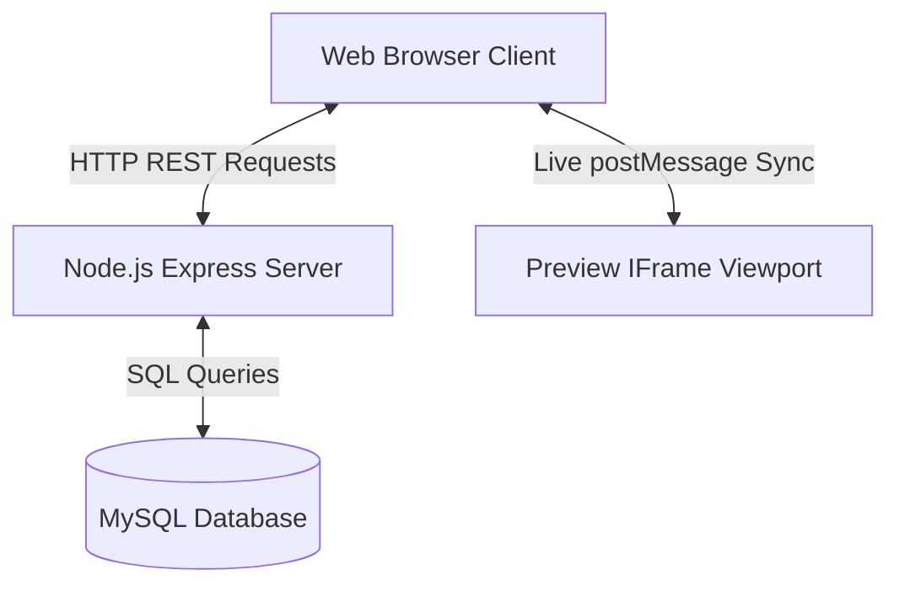

# High-Level Design (HLD): Build Your Link

This document details the system architecture, layout structures, data flows, and design paradigms of the **Build Your Link** platform—a premium, classic "Link-in-Bio" portfolio editor.

---

## 1. System Architecture

The application is structured as a light-footprint, zero-build, flat-file modular web application using a Node.js Express server backend and a MySQL database layer:



### Components
- **Client (Frontend)**: Standard HTML5, vanilla CSS (incorporating professional design systems and custom scrollbars), and pure JavaScript for interactivity and state syncing.
- **Application Server (Backend)**: Express.js web server handling authentication sessions, link CRUD actions, analytics logging, and public profile routing.
- **Database Layer (MySQL)**: Stores relational schemas for users, custom styles, link stack configurations, and daily visitor metrics.

---

## 2. Dynamic Desktop Workspace Design (3-Column Grid)

The user dashboard operates on a side-by-side **3-column desktop grid layout** designed to match the workspace flow of premium builders (like Liinks.co):

```
+-----------------------------------------------------------------------------+
|                                  Header                                     |
+------------------------------------+-----------------------------+----------+
|          Column 1: Content         |       Column 2: Design      | Col 3:   |
|                                    |                             | Preview  |
| - Display details (Avatar/Bio)     | - Preset Themes selector    |          |
| - Social platform connectors       | - Custom background hexes   | [ Mobile |
| - Add multi-type content blocks    | - Font systems & shapes     |  Mockup  |
| - Active block list (reorder/del)  | - Web vs Card presentation  |  Frame ] |
+------------------------------------+-----------------------------+----------+
```

1. **Content Rail**: Form structures for bio editing, platform connectors, block builders, and active list reordering (using SQL sort weights).
2. **Design Rail**: Visual selectors for themes, solid/gradient pickers, fonts, card corner styles, and layouts.
3. **Live Mockup Frame**: A floating simulated smartphone device frame rendering live content.

---

## 3. Real-Time Viewport Sync & Autosave Engine

To eliminate lag and page-refresh delays, the platform implements a dual-layer synchronization pipeline:

```
[User Input in Customizer]
         │
         ├──► (Instant) ──► HTML5 postMessage() ──► [IFrame Hydration] (Real-time Preview)
         │
         └──► (Debounced) ─► Fetch API (800ms) ──► [Express API] ──► [MySQL DB] (Persistent Save)
```

1. **Instant Preview (HTML5 postMessage)**:
   - Modifications inside the dashboard forms emit a `postMessage` payload containing the local state to the iframe viewport.
   - The iframe script parses the memory state and updates the layout immediately.
2. **Silent Autosave (Debounced)**:
   - Changes queue a background API save.
   - To avoid overloading the server or lock-freezing the user typing flow, the save request is **debounced by 800ms**.

---

## 4. Double Presentation Layouts

Desktop viewports support two dynamic display modes via a floating toggle switch:
- **Smartphone Mockup Layout (Mobile View)**: Centers the profile inside a phone-shaped border frame (`max-width: 380px`) with vertical scrolling locked to the phone frame. The main browser window has scrollbars disabled (`overflow: hidden`).
- **Full Webpage Layout (Web View)**: Presents the profile as a standard centered web portfolio (`max-width: 580px`) using the standard browser window scrollbars.

---

## 5. Security & Authentication Model

- **Bcrypt Hash Hashing**: User passwords are encrypted on registration using Blowfish-based hashing.
- **Express-Session Middleware**: Managed via secure server-side session cookies mapping user accounts.
- **Route Guards**: Secure API endpoints reject unauthenticated calls with a `401 Unauthorized` response.
